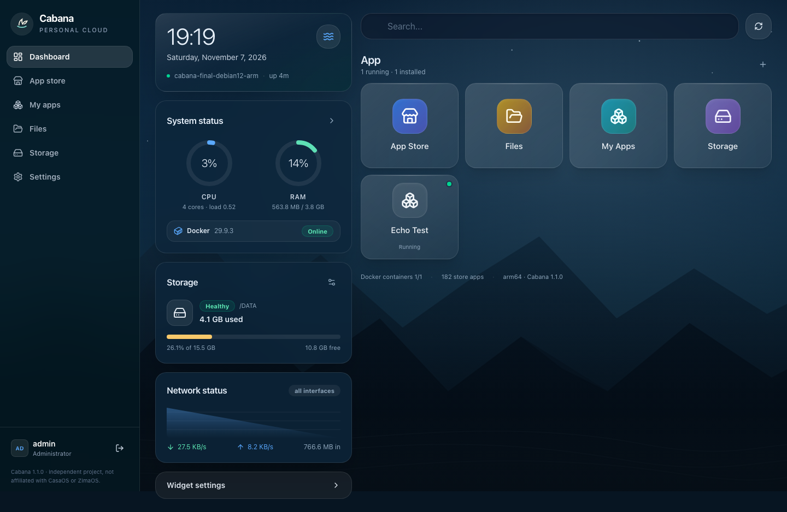

# Cabana

An independent, CasaOS-style personal cloud server for home Linux machines. Cabana gives
you a real host dashboard, a catalog of self-hosted apps sourced from the official
CasaOS/ZimaOS app store, a Docker app manager, a confined file browser, storage reporting,
and a first-run administrator flow — built from scratch and not affiliated with CasaOS or
ZimaOS. The interface uses shadcn-vue components with a CasaOS-inspired desktop layout.

```bash
curl -fsSL https://github.com/WisdomSky/Cabana/releases/latest/download/install.sh | sudo bash
```

Open the printed LAN URL, create the sole administrator account, and install your first app.
There are no default credentials.



## What you get

- **Dashboard** in a CasaOS-inspired layout: clock, real CPU/RAM rings, storage, network
  history, live app tiles, and search.
- **App store** backed by the official published CasaOS/ZimaOS v2 index, with search,
  categories, architecture filtering, relative compose/meta/asset resolution, and caching.
- **One-click app lifecycle**: install, start, stop, and uninstall store apps. Docker state
  is reconciled against Cabana's records. Port, container-name, volume, and Docker errors
  are surfaced in the UI.
- **CasaOS compose contract**: `x-casaos`, `$AppID`/`$PUID`/`$PGID`/`$TZ` substitution,
  `/DATA` app paths, and architecture-specific `docker-compose.<arch>.yml` variants.
- **Data safety**: uninstalling keeps app data unless you explicitly tick the delete-data
  confirmation. Named volumes are only removed with that explicit confirmation.
- **Custom Compose import**, including automatic analysis. Privileged, host-network, device,
  capability, and Docker-socket requests require an explicit checkbox before install.
- **File manager** confined to configured roots (default `/DATA`) with browse, upload,
  download, mkdir, rename, and delete, plus path-traversal and symlink-escape protection.
- **Storage overview** from real host filesystem statistics. Cabana never mounts, formats,
  or partitions disks.
- **Settings** for the administrator password, PUID/PGID/timezone, file roots, and store
  refresh.
- **Safe uninstaller** with interactive defaults that keep app data and Docker unless
  explicitly chosen otherwise.
- **`npm run docker`** local test mode: builds and runs Cabana in a container using the host
  Docker socket, without installing anything into the host OS.

## Supported systems

The installer supports **Debian 12 (bookworm)** and **Ubuntu 24.04 LTS (noble)** on
**amd64** and **arm64**, with systemd. Other systems and architectures are refused before
changes are made.

The installer must run as root. It:

- installs Docker Engine and the Compose plugin only when compatible versions are missing,
  and reuses a working existing Docker installation;
- installs a supported Node.js LTS (26.x) only when a compatible Node.js is missing;
- downloads the published release bundle and verifies its SHA-256 checksum;
- installs Cabana as an enabled systemd service on port 80;
- keeps state in `/var/lib/cabana` and app data in `/DATA`;
- is safely rerunnable and preserves the administrator account, files, and app data;
- performs no partitioning, formatting, or mounting.

Port 80 conflict or port override:

```bash
# If 80 is already in use, the installer names the process and refuses to change anything.
curl -fsSL https://github.com/WisdomSky/Cabana/releases/latest/download/install.sh | sudo CABANA_PORT=8080 bash
```

Useful commands on the server:

```bash
systemctl status cabana
journalctl -u cabana -f
```

## Uninstall

Download the uninstaller first so its interactive prompts can read a terminal:

```bash
curl -fsSL https://github.com/WisdomSky/Cabana/releases/latest/download/uninstall.sh -o /tmp/cabana-uninstall.sh
sudo bash /tmp/cabana-uninstall.sh
```

It asks separately whether to remove:

- Cabana state (`/var/lib/cabana`) and Cabana app data (`/DATA/AppData`) — default **no**;
- Docker Engine and **all** Docker containers, images, volumes, and networks — default **no**.

Both answers default to no, so simply pressing Enter keeps data and Docker. For automation:

```bash
sudo bash /tmp/cabana-uninstall.sh --yes                    # remove Cabana, keep data and Docker
sudo bash /tmp/cabana-uninstall.sh --yes --remove-data      # also remove Cabana state/AppData
sudo bash /tmp/cabana-uninstall.sh --yes --remove-docker    # also remove Docker + all Docker data
```

`--remove-docker` destroys every Docker workload on the host. Other files in `/DATA` outside
`AppData` are retained.

## Local testing in Docker

From a development checkout, without installing Cabana or Node on the host:

```bash
npm run docker
# open http://127.0.0.1:8080
```

The script builds a local image, mounts `.cabana-docker/` for state and app data, and passes
the host Docker socket into the container so store/custom apps are published on the host for
testing. It does not install host packages. Stop it without deleting data:

```bash
npm run docker:stop
```

This is a development convenience with root-equivalent Docker socket access; do not expose it
to untrusted users. Override the port with `CABANA_DOCKER_PORT=8090 npm run docker`.

## Evidence

Full commands, environment versions, timestamps, and outcomes are in
[`VERIFICATION.md`](VERIFICATION.md).

- Automated backend suite: **36 tests total**, including two real-Docker integration tests
  (lifecycle and volume-failure surfacing) run separately. Coverage includes setup/auth,
  sessions/CSRF, store parsing and compose translation, file confinement, app lifecycle,
  and settings.
- Playwright E2E: **6 scenarios** covering first-run, login/logout, the shadcn-vue dashboard,
  storage, store search/category/architecture filtering, install/start/stop/uninstall with
  data preservation and explicit deletion, custom Compose import, privileged confirmation,
  file operations, settings, and desktop/narrow screenshots.
- Uninstaller: interactive defaults keep Cabana state, app data, and Docker. Both the safe
  default and the explicit `--remove-data --remove-docker` path were tested on disposable VMs.
- `npm run docker`: first-run setup and a real Uptime Kuma store install verified inside a
  local container using the host Docker socket, with state under `.cabana-docker/`.
- Clean-VM matrix: Debian 12 and Ubuntu 24.04 on amd64 and arm64. Debian 12 arm64 runs the
  full suite, a real reboot, and an idempotent second install with data hashes unchanged.
  Ubuntu 24.04 amd64/arm64 run the exact public one-liner on GitHub-hosted clean VMs
  ([final run](https://github.com/WisdomSky/Cabana/actions/runs/42367982882)); Debian 12
  amd64 runs the same one-liner followed by setup, login, and a store app install.
- Sampled official-store installs: Uptime Kuma 2.4.0, Gitea 1.26.2, and multi-service
  Immich 2.7.2 (server, machine learning, PostgreSQL, Redis). All containers were healthy
  or running and the app URLs returned successful responses.
- Installer safety: busy-port refusal with process identification, documented override,
  unsupported Fedora refusal, non-root refusal, safe rerun, and rollback path.
- UI stack: shadcn-vue-style components built on Reka UI primitives, shared design tokens,
  and a CasaOS-inspired dashboard layout.

Screenshots: [`docs/screenshots`](docs/screenshots).

## Technology

- Backend: Node.js 24+ / Express / `node:sqlite`
- Frontend: Vue 3 / shadcn-vue components (Reka UI) / Tailwind CSS 4 / Vite
- Apps: Docker Compose via the server-side Docker CLI
- Store: official CasaOS/ZimaOS v2 index from jsDelivr

## Security model

- Sole administrator, created on first run; setup permanently closes afterwards.
- Passwords hashed with scrypt and per-user random salts.
- Random session tokens stored only as SHA-256 hashes; session cookie is HttpOnly,
  SameSite=Lax, and `Secure` when configured for TLS.
- Every authenticated state-changing request requires a per-session CSRF token and a
  same-origin check.
- Docker access is server-side only; the browser never receives a Docker socket or API.
- File paths are confined to configured roots; traversal and symlinks resolving outside a
  root are refused.
- Custom Compose files requesting privileged mode, host networking/PID/IPC, devices,
  capabilities, sensitive mounts, or the Docker socket require explicit confirmation.
- Passwords, session tokens, and CSRF tokens are never written to logs.

Cabana is intended for a trusted home LAN. TLS, remote access, and multi-user roles are out
of scope for v1.

## Limitations (v1)

- No TLS termination, remote-access tunnel, or authentication proxy.
- Single administrator; no multi-user accounts or roles.
- No disk mounting, partitioning, formatting, or SMB sharing.
- No backup/restore, snapshot, or app-upgrade tooling.
- No third-party/app-store management.
- No Cabana uninstall or upgrade command beyond safely rerunning the installer.
- Custom Compose images and definitions are not vetted by Cabana. File management and the
  service run with root privileges so Cabana can manage root-owned app data and Docker.
- App URLs point directly at published host ports; the host firewall must allow them.

## Development

Requirements: Node.js 24+ and Docker for the Docker-backed tests and runtime features.

```bash
npm run setup
npm --prefix server test
CABANA_REAL_DOCKER=1 node --test server/test/docker.integration.test.js
npm --prefix web run build
bash scripts/build-release.sh
npm --prefix e2e install
npm --prefix e2e exec playwright install chromium
```

Run the backend locally against disposable state (use a Docker-shared host path for the
data directory so bind mounts resolve):

```bash
CABANA_STATE_DIR=/tmp/cabana-state \
CABANA_DATA_DIR=/tmp/cabana-data \
CABANA_WEB_DIR="$PWD/web/dist" \
CABANA_PORT=8080 \
node server/src/start.js
```

End-to-end tests start their own disposable server unless `CABANA_E2E_BASE_URL` is set:

```bash
npm --prefix e2e test
CABANA_E2E_BASE_URL=http://127.0.0.1 npm --prefix e2e test -- --grep @persistence
```

## Credits

App definitions, icons, screenshots, and catalog metadata come from the
[official CasaOS/ZimaOS App Store](https://github.com/IceWhaleTech/CasaOS-AppStore).
Cabana is an independent project and is not affiliated with, endorsed by, or sponsored by
CasaOS or ZimaOS. See [`NOTICE`](NOTICE).

## License

MIT. See [`LICENSE`](LICENSE).
